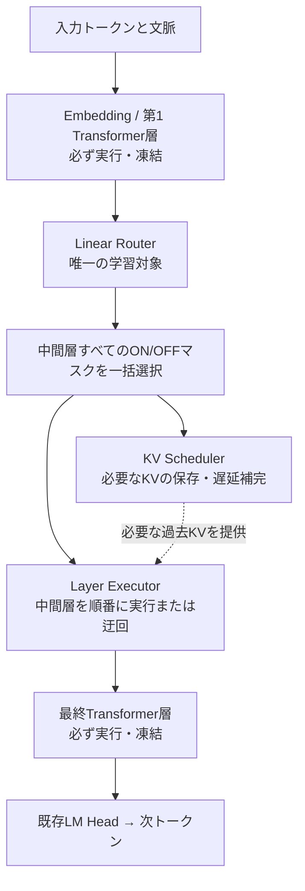

# 01｜研究目的・確定仕様・モデル構造

> **状態：** 研究設計。以下の確定仕様はユーザーが指定した方針。品質改善・高速化は未検証の仮説。

## 研究の問い

**凍結済みLLMの第1層後の特徴だけから、中間Transformer層すべてのON/OFFをトークンごとに一括決定し、実際の文章生成の報酬でLinear Routerを学習する。これに、スキップ層の遅延KV補完を結合することで、元モデルの品質を維持または改善しつつ、実GPU生成時間を短縮できるか。**

### 達成したいこと

1. **品質維持：** 全層実行を基準として、品質非劣性の範囲に収める。
2. **品質改善：** 全層実行モデルが誤る入力で、スキップが有利になる可能性を、未見問題で検証する。
3. **GPU高速化：** Router・分岐・KV補完・同期も含めた実測Decode時間を縮める。
4. **共同最適化の検証：** KV Schedulerを単純に後付けした場合より、補完費用を考慮してRouterを学習し直す方が有利か比較する。

### 研究対象

| 項目 | 第1段階（手法・正確性） | 第2段階（大規模検証） |
|---|---|---|
| モデル | [Qwen3-0.6B](https://huggingface.co/Qwen/Qwen3-0.6B) | [Nanbeige4.3-33B](https://huggingface.co/Nanbeige/Nanbeige4.3-33B) |
| Transformer層数 | 28 | 52 |
| 隠れ幅 | 1,024 | 7,168 |
| 必須実行 | 第1・28層 | 第1・52層 |
| スキップ候補 | 第2〜27層（26個） | 第2〜51層（50個） |
| Linear Router出力数 | 26 | 50 |
| Routerパラメータ（biasあり） | 26,650 | 358,450 |

これらの構造値は初期モデル仕様に基づく。実装時に**モデルrevisionとconfigを再確認して固定**する。3B・7Bなどの中間モデルは使用しない。

## 確定仕様（変えない骨格）

- **全重み凍結：** Embedding・全Transformer層・LM Headは更新しない。学習するモデルパラメータはLinear Routerだけ。
- **第1・最終層は必ず実行。**
- **Routerは1トークンにつき1回、全中間層のON/OFFをまとめて出力する。** 各中間層に個別の判定ヘッドを配置するわけではない。
- Routerは層間の隠れ状態を直列変換する層ではなく、**計算経路の制御器**。
- 学習時は**ランダムな組み合わせで実際に自己回帰生成**し、全経路の品質・費用の報酬からRouterを更新する。単純な教師モデル一致だけを最適化しない。
- 初期実装では**Prefillは全層、Decodeのみ動的Layer Skipping**。
- 第2段階では**Router重みを移植せず**、同じ学習法でNanbeige用Routerを再学習する。
- **研究に期限を置かない。** 完了条件で進行を管理する。

## 推論の概念図

図は論理関係。Schedulerは**層実行中**に参照され、単純に最終層の後で起動する処理ではない。

### 5層の具体例

第1・5層は必ずON。中間層2〜4のマスクは例えば `[1,0,1]` であり、**第2・4層を実行、第3層をスキップ**する。次トークンでは別の組み合わせを選べる。中間3層には8通り、Qwen3の26層には2^26通りの二値マスクがある。

## 何を「未実証」とするか

- 第1層の特徴だけで必要な層を正確に判別できるか。
- Linearの出力が各層の条件付き独立な確率でも、層間相互作用を十分学習できるか。
- 元モデルより良い経路が**学習済みRouterの一回の選択**で見つかるか。
- EagerよりLazyが高速または省メモリになるか。
- Qwen3とNanbeigeでGPU速度利益が得られるか。
- 提案方式と先行研究との差分が、論文として独立した貢献となるか。

次の文書：[02 Router学習](02_ROUTER_TRAINING.md) ／ [文書ガイド](README.md)
