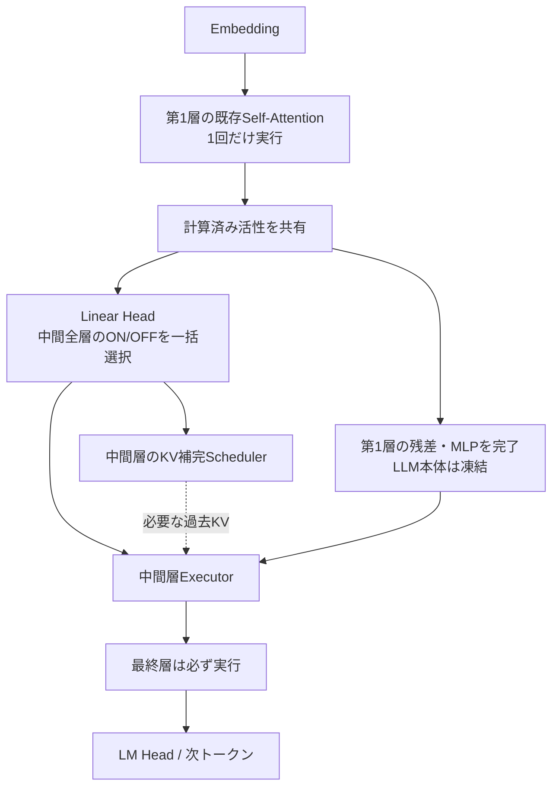

# 01｜研究の骨格（正本）

> **この文書が研究目的・確定仕様の正本。** 他の研究案で上書きしない。現段階は設計のみ、実装・学習・GPU計測なし。

## 研究目的

**既存LLMの第1層Self-Attentionの計算済み活性を再利用し、単一の学習可能なLinear Headで各Decodeトークンの中間Transformer層すべての実行領域（ON/OFF）を一括選択する。**

生成軌跡の正解性と実GPU計算費用から、**Linear Headだけ**を学習する。モデルを全層実行する場合との品質維持・品質改善を研究し、欠損KVの正確な補完によって動的な経路を実行可能にする。

**優先順位は、①共有活性、②Linear Headによる動的な全中間層選択、③生成中学習、④KV整合性・GPU費用である。** KV補完負債やキャッシュ管理を、Headが学習する実行領域の代わりの研究目的にはしない。

## 確定している前提

| 観点 | 固定仕様 |
|---|---|
| モデル | **Qwen3-0.6B → Nanbeige4.3-33B**の2段階。3B/7B中間モデルは設けない |
| LLM本体 | Embedding・Transformer全層・LM Headを**凍結** |
| 学習対象 | **1つのLinear Head**（重み・bias）。新しいAttention／LLM／Adapterを学習しない |
| 活性再利用 | **第1層Self-Attentionを既存LLMとHeadで共有**し、Head専用にもう一度計算しない |
| 必須実行 | **最初と最後のTransformer層**。第1層Attentionだけでなく、残りのMLPも実行してBlockを完了 |
| Headの役割 | トークンごとに**全中間層のON/OFFマスクを一括出力**。層を逐次判定する別Head群ではない |
| 学習 | 実際の自己回帰生成で多様なマスク経路を探索し、**全経路のタスク品質・費用**でHeadを更新 |
| 出力品質 | 元モデルへの模倣だけでなく、元モデルの誤答を正せるかも評価する |
| KV Cache | Skipした中間層を後で実行する場合、過去KVの欠損を**正しい層入力から**補完する |
| 初期の処理範囲 | Prefillは全層、Decodeは動的Skip |
| 研究の管理 | **期限なし。** コード・測定結果・研究日誌を無断追加しない |

### モデル別の制御範囲

| モデル | Transformer層数 | 常時ON | 一括選択する層 | Linear出力 |
|---|---:|---|---|---:|
| [Qwen3-0.6B](https://huggingface.co/Qwen/Qwen3-0.6B) | 28 | 第1・28層 | 第2〜27層 | 26 |
| [Nanbeige4.3-33B](https://huggingface.co/Nanbeige/Nanbeige4.3-33B) | 52 | 第1・52層 | 第2〜51層 | 50 |

数値は対象の公開Configに基づく。使用するModel Revision・Backendは、実装段階になってから固定する。

## 主経路の依存関係

**決定的な区別：** Linear Headへ与える「第1Attentionからの活性」と、**中間層Executorへ与える第1Block完了後の隠れ状態は同じとは限らない**。元の第1層処理を勝手に省かない。Headは実行を選ぶ**制御出力**を出し、LLMのHidden Stateに加えるAdapterではない。

活性の厳密な接続位置は[11 共有活性の仕様](11_SHARED_ACTIVATION_ROUTING.md)が正本。**Attentionの出力ベクトル**、**Attention重み**、**第1Block完了後の出力**を混同しない。どのTensorをHeadが読むかは未確定の技術的選択であり、助手が一方的に決めない。

## 学習の意味

- 毎トークン、**Linear Headが全中間層についてそれぞれON/OFFを出す**。ある層を必ず連続してSkipするとは限らない。
- 学習の教師は「スキップする層の固定リスト」ではなく、**実際の生成経路のタスク報酬**。ランダム探索の方式、REINFORCE/RLOO等は[02](02_ROUTER_TRAINING.md)で提案として扱う。
- 全LLM重みは凍結。Nanbeigeでは、新しい入力次元・中間層数に対応する**別のLinear Headを再学習**。
- **同じマスクを維持すること、末尾OFFを伸ばすこと、マスクを変えること自体を報酬にしない**。各Tokenの内容に応じて最適な組合せを選ぶ。
- 固定マスクは比較対象であり、主方式ではない。

## 従属的な研究課題（確定仕様ではない）

- [03 正確なKV補完](03_KV_CACHE.md)：Eager、On-demand、Batched、共有保存の違い。
- [06 最適化余地](06_OPTIMIZATION_TARGETS.md)・[08 初回KV需要](08_KV_FIRST_USE_MODEL.md)・[09 最終ON位置](09_LAST_USE_BOUND.md)：KVの費用・メモリを理解する**補助分析**。同じ層をスキップし続ける学習原則とはしない。
- [07 学習方策候補](07_POLICY_LEARNING_PIPELINE.md)：実GPU費用をRouter学習へ加える拡張案。新しい訓練可能なモデルを作らない。
- [10 新規性監査](10_NOVELTY_AND_RATIONALITY.md)：先行研究との境界。**新規性は未確認**。

**位置付け：** この研究はRouterの動的実行領域選択が主で、KV補完はその正確性と実効GPU費用を扱う機構である。**活性共有は初期設計からの制約であり、新規に発見した高速化成果ではない。**

[11 共有活性とLinear Head](11_SHARED_ACTIVATION_ROUTING.md)｜[02 学習](02_ROUTER_TRAINING.md)｜[文書ガイド](README.md)
