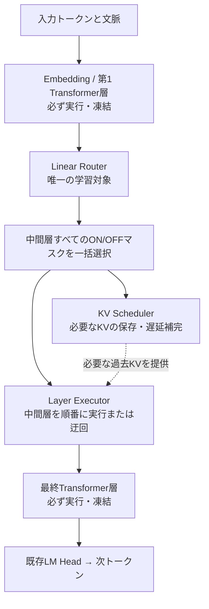

# 01｜研究目的・確定仕様・モデル構造

> **状態：** 研究設計。以下の確定仕様はユーザーが指定した方針。品質改善・高速化は未検証の仮説。

## 研究の問い

**凍結済みLLMの第1層後の特徴だけから、中間Transformer層すべてのON/OFFをトークンごとに一括決定し、実際の文章生成の報酬でLinear Routerを学習する。これに、スキップ層の遅延KV補完を結合することで、元モデルの品質を維持または改善しつつ、実GPU生成時間を短縮できるか。**

### 達成したいこと

1. **品質維持：** 全層実行を基準として、品質非劣性の範囲に収める。
2. **品質改善：** 全層実行モデルが誤る入力で、スキップが有利になる可能性を、未見問題で検証する。
3. **GPU高速化：** Router・分岐・KV補完・同期も含めた実測Decode時間を縮める。
4. **共同最適化の検証：** KV Schedulerを単純に後付けした場合より、補完費用を考慮してRouterを学習し直す方が有利か比較する。

### 研究対象

| 項目 | 第1段階（手法・正確性） | 第2段階（大規模検証） |
|---|---|---|
| モデル | [Qwen3-0.6B](https://huggingface.co/Qwen/Qwen3-0.6B) | [Nanbeige4.3-33B](https://huggingface.co/Nanbeige/Nanbeige4.3-33B) |
| Transformer層数 | 28 | 52 |
| 隠れ幅 | 1,024 | 7,168 |
| 必須実行 | 第1・28層 | 第1・52層 |
| スキップ候補 | 第2〜27層（26個） | 第2〜51層（50個） |
| Linear Router出力数 | 26 | 50 |
| Routerパラメータ（biasあり） | 26,650 | 358,450 |

これらの構造値は初期モデル仕様に基づく。実装時に**モデルrevisionとconfigを再確認して固定**する。3B・7Bなどの中間モデルは使用しない。

## 確定仕様（変えない骨格）

- **全重み凍結：** Embedding・全Transformer層・LM Headは更新しない。学習するモデルパラメータはLinear Routerだけ。
- **第1・最終層は必ず実行。**
- **Routerは1トークンにつき1回、全中間層のON/OFFをまとめて出力する。** 各中間層に個別の判定ヘッドを配置するわけではない。
- Routerは層間の隠れ状態を直列変換する層ではなく、**計算経路の制御器**。
- 学習時は**ランダムな組み合わせで実際に自己回帰生成**し、全経路の品質・費用の報酬からRouterを更新する。単純な教師モデル一致だけを最適化しない。
- 初期実装では**Prefillは全層、Decodeのみ動的Layer Skipping**。
- 第2段階では**Router重みを移植せず**、同じ学習法でNanbeige用Routerを再学習する。
- **研究に期限を置かない。** 完了条件で進行を管理する。

## 推論の概念図



図は論理関係。Schedulerは**層実行中**に参照され、単純に最終層の後で起動する処理ではない。

### 5層の具体例

第1・5層は必ずON。中間層2〜4のマスクは例えば `[1,0,1]` であり、**第2・4層を実行、第3層をスキップ**する。次トークンでは別の組み合わせを選べる。中間3層には8通り、Qwen3の26層には2^26通りの二値マスクがある。

## 改良候補A：KV補完負債を考慮する設計（**提案・未確定**）

### なぜ必要か

現行のLinear Routerは第1層後の特徴だけから現在のマスクを一括予測する。ところが、**同じ特徴から予測したとしても、過去にスキップした層のKVが準備済みか、未補完かによって、次にその層を実行する実際の費用は違う**。

そこでモデル本体・Routerの構造を変えずに、**KV補完負債（KV reconstruction debt）をGPU費用上の状態として定義する**ことを提案する。これは「保存したデータ量」だけではなく、「次にその層を実行するときに要求される再構成と待機」を含む概念。

### 責任を混ぜない

| 要素 | やること | やらないこと |
|---|---|---|
| **Linear Router** | 第1層出力から、全中間層のON/OFF候補を1回で出す | 新しいTransformer表現を作らない |
| **Layer Executor** | 選択済みマスクに従い、層を順番に実行／スキップする | 勝手にマスクを変更しない |
| **KV Scheduler** | Eager、保存、必要時の再構成、一括補完、メモリ予算を管理する | **Routerの実行マスクを無断で上書きしない** |
| **費用の評価** | 経路の品質・現在の計算費用・将来の補完費用を評価する | 層スキップ率だけを速度の代用にしない |

Schedulerの判断で保存領域が足りなければ、**マスクを書き換えるのではなく**、補完の前倒し・Eager生成・明示的な容量不足の扱いで対処する。実行可能性を保証できない場合、黙って別マスクに変えて「同じ経路の比較」をしてはいけない。

### 最小限の改良：学習可能な層を増やさず費用を反映

第1段階では**従来のLinear Routerをそのまま基準方式**とする。次の方式は比較対象となる**理論的な改良候補**であり、確定仕様ではない。

**変数表**

| 記号 | 意味（日本語・定義） | SI単位 | 定義域・範囲・前提 | 型 |
|---|---|---|---|---|
| \(t\) | Decode位置 | 1 | 正整数 | 整数 |
| \(j\) | 中間Transformer層 | 1 | 2〜L−1 | 整数 |
| \(L\) | Transformer層数 | 1 | 28または52 | 整数 |
| \(h_t\) | 第1層出力 | 1 | \(\mathbb R^d\) | ベクトル |
| \(d\) | 隠れ幅 | 1 | 対象モデルのconfigで固定 | 整数 |
| \(W_j,b_j\) | Linear Routerの第j層用行重み・bias | 1 | \(W_j\in\mathbb R^{1\times d}, b_j\in\mathbb R\) | 行ベクトル・スカラー |
| \(D_t\) | 当該時点のKV準備状況・共有保存状態・未補完負債 | 1 | 層・トークン単位の状態集合 | 離散状態 |
| \(\widehat C^{\mathrm{on}}_{t,j}\) | 層jを実行するときの予測実効費用 | s | 0以上、他層の選択について近似が必要 | スカラー |
| \(\widehat C^{\mathrm{off}}_{t,j}\) | 層jをスキップするときの予測実効費用 | s | 0以上、将来の再構成・保存費用を含む代理値 | スカラー |
| \(\beta\) | 費用補正の強さ | s⁻¹ | 0以上、設計上の固定係数 | スカラー |
| \(z_{t,j}\) | 元のLinear Routerロジット | 1 | 実数 | スカラー |
| \(\widetilde z_{t,j}\) | 費用補正後のロジット | 1 | 実数 | スカラー |
| \(\sigma\) | Sigmoid | 1 | \(\mathbb R \to (0,1)\) | 関数 |
| \(\widetilde p_{t,j}\) | 費用補正後の実行確率 | 1 | (0,1) | 確率 |

まず、元のRouterは全中間層のロジットを**一括**出す：

```math
z_{t,j}=W_jh_t+b_j
```

KV費用を参照する**非学習の補正**を別の設計候補として定義できる：

```math
\widetilde z_{t,j}=
z_{t,j}-
\beta\left(\widehat C^{\mathrm{on}}_{t,j}-\widehat C^{\mathrm{off}}_{t,j}\right),
\qquad
\widetilde p_{t,j}=\sigma(\widetilde z_{t,j})
```

- **\(\beta=0\)** なら現行Routerと同一。最初の骨格を壊さない。
- Schedulerの補完負債により、現在ON/OFFの費用見積りが変われば、**追加学習パラメータなし**で実行確率へ反映できる。
- 26/50個の確率は一括生成され、**スキップ数を1個に限定しない**。
- この差分費用は**層ごとの近似**であり、層間の相互作用、GPUバッチの重み共有、複数層の同時補完を厳密に表すとは限らない。最適性を主張しない。
- 学習時にこの補正を使用した場合、REINFORCEは**補正後の実際のサンプリング確率**を使わなければならない。費用補正・探索ノイズを無視した更新は別の方策を学習してしまう。
- そもそも、固定の第1層特徴だけを使うRouterは、KV負債が異なっていても同じ特徴なら同じ確率を返す。これが状態依存の費用補正を検討する数学的動機となる。

**次元チェック：** \(W_jh_t+b_j\) は無次元。予測費用の差は秒(s)、\(\beta\) はs⁻¹なので補正項は無次元。Sigmoidへの入力として整合する。

**ERROR CHECK：** この式は**設計候補**であり、計算費用の見積りが正しいこと・品質が保たれること・GPUが高速化することを証明しない。中間層の相互作用を近似するだけであり、最適な全マスクの厳密な求解ではない。

### 先行研究との差分を主張する際の注意

- [Dr.LLM (2025, arXiv:2510.12773)](https://arxiv.org/abs/2510.12773)は凍結LLMへRouterを後付けし、MCTS教師探索で経路を学習する。
- [vSkipper (2026, arXiv:2609.37062)](https://arxiv.org/abs/2609.37062)は動的スキップとGPU Servingの連携、および実行利益に応じた方式選択を扱う。
- [AnchorKV (2026, arXiv:2611.00117)](https://arxiv.org/abs/2611.00117)は残差状態からのKV再構成と保存・再計算の関係を扱う。

したがって**「軽量Router」「遅延KV」「GPUにおける利益判定」自体は独自の発明として扱わない**。独自性の候補は、**生成中に学習する全中間層マスクの選択と、動的に蓄積するKV補完負債を一つの品質・時間最適化問題として結ぶこと**に置く。現時点では新規性も有効性も**未確定**。

## 何を「未実証」とするか

- 第1層の特徴だけで必要な層を正確に判別できるか。
- Linearの出力が各層の条件付き独立な確率でも、層間相互作用を十分学習できるか。
- 元モデルより良い経路が**学習済みRouterの一回の選択**で見つかるか。
- EagerよりLazyが高速または省メモリになるか。
- Qwen3とNanbeigeでGPU速度利益が得られるか。
- 提案方式と先行研究との差分が、論文として独立した貢献となるか。

研究上の独自性を評価する前に、[先行研究・技術的出典台帳](PRIOR_ART_AND_ATTRIBUTION.md)と[10 新規性・合理性の監査](10_NOVELTY_AND_RATIONALITY.md)で既知要素との対応を確認する。

確定済みの骨格を壊さない改良方策は、**別途[06 最適化対象](06_OPTIMIZATION_TARGETS.md)と[07 方策学習パイプライン](07_POLICY_LEARNING_PIPELINE.md)へ「提案・未確定」として記録**する。補完負債の将来需要を独立性を仮定せず整理する精密モデルは[08 初回KV需要・補完費用](08_KV_FIRST_USE_MODEL.md)に置く。

次の文書：[02 Router学習](02_ROUTER_TRAINING.md) ／ [文書ガイド](README.md)
