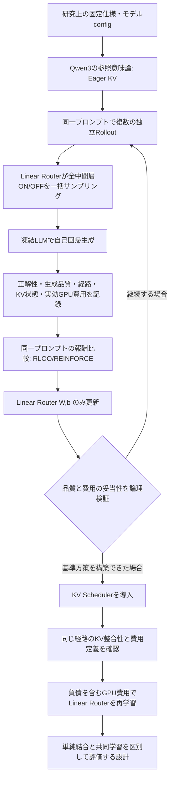

# 07｜経路選択とKV補完の学習方策パイプライン（設計案）

> **状態：研究設計。** この文書は「何を最適化し、どういう信号でLinear Routerを学習するか」の仕様候補。**学習実装・学習実行・GPUベンチマークは行っていない。** 期限は設けない。

## 0. 骨格（既に確定）

- 凍結LLM：Embedding・全Transformer層・LM Headの重みは更新しない。
- **第1層・最終層は必ず実行**。その他の全中間層をON/OFF候補とする。
- 現在トークンについて**第1層の隠れ状態から一つのLinear Routerがマスク全体を一括生成**する。
- ランダムなマスクで**実際に自己回帰生成**し、出力品質と実行費用から**Linear Routerだけ**学習する。
- 元モデルとの出力一致だけを目的にしない。元モデルの誤答が正解になる経路も評価する。
- 初期はQwen3-0.6B、続いてNanbeige4.3-33B。中間3B/7Bなし。
- **Schedulerは学習可能な別ネットワークではなく、KVの保存・補完を行う規則ベース制御器**とする。

## 1. 学習の全体像



*図はデータと最適化の論理的な依存関係。現時点でどの工程も実行したとは扱わない。*

## 2. 状態・行動・更新範囲

### 変数表（全数式の定義）

| 記号 | 意味（日本語・定義） | SI単位 | 定義域/条件 | 型 |
|---|---|---|---|---|
| \(L\) | Transformer層数 | 1 | 28または52 | 正整数 |
| \(d\) | 第1層後の隠れ幅 | 1 | 1024または7168 | 正整数 |
| \(t,u\) | 現在／任意のDecode位置 | 1 | 正整数 | 整数 |
| \(j\) | 中間Transformer層番号 | 1 | 2〜L−1 | 整数 |
| \(h_t\) | 第1層後の隠れ状態 | 1 | \(\mathbb R^d\) | ベクトル |
| \(D_t\) | 層別の未補完位置・共有入力・KV準備状態 | 1 | 有限の状態集合 | 離散状態 |
| \(s_t\) | 生成履歴・第1層特徴・KV準備状態を含む状態 | 1 | 生成過程の状態集合 | 状態 |
| \(W\) | Linear Router重み | 1 | \(\mathbb R^{(L-2)\times d}\) | 行列 |
| \(b\) | Linear Routerバイアス | 1 | \(\mathbb R^{L-2}\) | ベクトル |
| \(\theta\) | 学習対象 | 1 | (W,b)だけ | パラメータ組 |
| \(z_{t,j}\) | 中間層のRouterロジット | 1 | 実数 | スカラー |
| \(\widetilde z_{t,j}\) | 任意の費用補正後ロジット | 1 | 実数 | スカラー |
| \(\Delta\widehat C_{t,j}\) | ON対OFFの予測実効GPU費用差 | s | 実数・状態依存 | スカラー |
| \(\beta\) | 費用差の固定重み（学習対象外） | s⁻¹ | 非負 | スカラー |
| \(\sigma\) | Sigmoid | 1 | \(\mathbb R\to(0,1)\) | 関数 |
| \(p_{t,j}\) | Router実行確率 | 1 | (0,1) | 確率 |
| \(\varepsilon\) | 独立探索ビット反転確率 | 1 | [0,0.5) | スカラー |
| \(q_{t,j}\) | 実際のサンプリング確率 | 1 | (0,1) | 確率 |
| \(m_{t,j}\) | 層の実行有無（1がON） | 1 | {0,1} | 二値 |
| \(m_t\) | 全中間層の実行マスク | 1 | \(\{0,1\}^{L-2}\) | 二値ベクトル |
| \(\pi_\theta\) | その状態での全中間層マスクの方策分布 | 1 | 確率分布 | 確率 |
| \(x\) | 入力プロンプト | 1 | 離散系列 | 系列 |
| \(\tau\) | プロンプトに対するマスクと出力トークンの全軌跡 | 1 | 離散系列 | 軌跡 |
| \(T\) | 軌跡のDecodeステップ数 | 1 | 正整数 | 整数 |
| \(Q(\tau)\) | タスク品質・正解報酬 | 1 | 原則[0,1] | スカラー |
| \(c_t\) | 時刻tの実効Decode経過時間 | s | 非負 | スカラー |
| \(T_{\rm decode}\) | 軌跡の総Decode経過時間 | s | 正 | スカラー |
| \(T_0(x)\) | 同条件の全層Baseline生成時間 | s | 正 | スカラー |
| \(\lambda\) | 時間費用重み | 1 | 非負 | スカラー |
| \(R(\tau)\) | 軌跡の品質・速度報酬 | 1 | 実数 | スカラー |
| \(G_t\) | 時刻tから先のReturn-to-go（終端品質と残り費用） | 1 | 実数 | スカラー |
| \(b_{\rm LOO}\) | 他の独立Rolloutから計算する基準報酬 | 1 | 実数 | スカラー |
| \(J(\theta)\) | 期待報酬 | 1 | 実数 | スカラー |
| \(\Phi(s)\) | 任意の固定されたポテンシャル関数 | 1 | 実数、終端状態では0 | 関数 |
| \(r_t\) | もとの時間別報酬（終端品質を含み得る） | 1 | 実数 | スカラー |
| \(r'_t\) | ポテンシャルによる変換後の時間別報酬 | 1 | 実数 | スカラー |
| \(M_{\rm peak}\) | ピークGPU占有メモリ | B | 非負 | スカラー |
| \(M_{\rm budget}\) | 上限となるGPUメモリ予算 | B | 正 | スカラー |
| \(Q_0,\delta_Q\) | 全層モデルの期待品質／許容品質低下 | 1 | 実数／非負 | スカラー |

### 2.1 アクションは全中間層のマスク

元の確定仕様に対応する**基準方策**：

```math
z_t=Wh_t+b,\qquad p_{t,j}=\sigma(z_{t,j})
```

```math
q_{t,j}=\varepsilon+(1-2\varepsilon)p_{t,j},\qquad
m_{t,j}\sim \mathrm{Bernoulli}(q_{t,j})
```

```math
\pi_\theta(m_t\mid s_t)=\prod_{j=2}^{L-1}
q_{t,j}^{m_{t,j}}(1-q_{t,j})^{1-m_{t,j}}
```

**注意：** この基準方策では \(p_t\) はhの関数のみ。状態 \(s_t\) に含まれる \(D_t\) は、報酬・Scheduler側では扱うが、**Router入力に直接は入れない**。26/50個のON/OFFを一括生成する骨格を保つ。

### 2.2 任意の追加方策：非学習の負債コスト補正

本研究の独自性候補を強める**未確定の追加方式**。上記基準方式との比較を維持する。

```math
\widetilde z_{t,j}=z_{t,j}-\beta\Delta\widehat C_{t,j}(D_t),
\qquad p_{t,j}=\sigma(\widetilde z_{t,j})
```

- \(\Delta\widehat C_{t,j}\) はONとOFFを選んだ場合の、**将来補完・待機まで含む推定実効費用の差**。補正に新しいニューラルネットを訓練しない。
- 費用差は全マスクの相互作用を含む真値ではなく**層別近似**。他の層の選択が同時に変わる場合の効果を正確には表現しない。
- \(\beta=0\) で基準方策に一致。**基準方式から無断で置換しない。**
- 補正値は**マスクをサンプリングする前の状態だけ**から決める。サンプル後に別ルールでマスクを変更すると、上記の積分布は実行マスクの分布でなくなる。

**次元チェック：** W h+b、Sigmoid入力は無次元。費用差は秒、\(\beta\) は秒の逆数で、補正も無次元。

## 3. 品質を主軸にした制約付き目的

品質非劣性を時間ペナルティの重みだけで**保証できるとは仮定しない**。

初期の学習代理目的は

```math
R(\tau)=Q(\tau)-\lambda \frac{T_{\rm decode}}{T_0(x)},
\qquad J(\theta)=\mathbb E_{x,\tau}[R(\tau)]
```

で表せるが、研究の**最終目標**はむしろ

```math
\min_{\theta}\mathbb E[T_{\rm decode}]\quad
\mathrm{subject\ to}\quad
\mathbb E[Q(\tau)]\ge Q_0-\delta_Q,\quad
M_{\rm peak}\le M_{\rm budget}\ \text{(all valid runs)}
```

という制約付き最適化である。ここでSchedulerは同じ定義済みの実行規則を用い、Routerの学習対象はθのみ。メモリ制約は**アロケータ/容量として守る実行上の不変条件**であり、平均メモリが小さいという意味ではない。

**次元チェック：** 最小化目的はs。品質制約は無次元、メモリ制約はバイト同士。代理報酬の時間比はs/sで無次元。

**注意：** 代理報酬による最大化と制約付き最小化は一般に同値ではない。Lagrange係数を1つ選べば品質下限を必ず満たすという主張もしない。制約付きRLの既存研究は[出典台帳](PRIOR_ART_AND_ATTRIBUTION.md)へ記録する。

**報酬崩壊の設計上の注意：** 同じプロンプトのすべてのRolloutが不正解（品質報酬が全て0）なら、時間ペナルティだけが識別信号として残り、**高速だが不正解の経路を優先する方向に偏る危険**がある。初期の学習では、タスク正解性の検証器と品質下限を優先し、必要なら正解に関する**部分点・検証可能な中間信号**を設計する。元モデルとの一致だけを品質の代用にしない。また、品質に有意な差がない群のみでGPU費用の比較をする場合も、その条件を明記する。これは実装前の設計上のリスクであり、対策の有効性は未確認。

## 4. 生成中にRouterを学習する方策

### 4.1 最小で成立する方式：独立Rollout＋RLOO

1. 同じプロンプトから、**同じ更新前Router**で複数のRolloutを**独立**に生成する。
2. 各トークンの**マスク、選択時の確率、モデルの生成トークン、KV負債・補完操作・費用**を残す。
3. 終端までのタスク品質を評価。元の全層出力との差は主報酬にしない。
4. 各Rolloutの終端報酬を、**同じプロンプトの他Rollout平均**で基準化する。
5. 実際のサンプリング確率に対する対数確率勾配で、**W,bだけ**更新する。
6. **更新後**のRouterで再度Rolloutする。古い軌跡をon-policyと呼ばない。

方策勾配の基本形：

```math
\nabla_\theta J=
\mathbb E\!\left[(R(\tau)-b_{\rm LOO})
\sum_{t=1}^{T}\nabla_\theta\log\pi_\theta(m_t\mid s_t)\right]
```

**正当化：** 凍結LLMと現在の履歴・選択マスクを固定すれば、次トークン分布はRouterのθに直接依存しない。経路（マスク）確率のスコア関数を微分するREINFORCEで、凍結LLMの重みを逆伝播する必要はない。LOO基準値は対象Rolloutから独立であれば、その期待勾配を変えない。

**ERROR CHECK：** 同じグループ内でRouterを途中更新したり、共通の乱数を共有してRollout同士が条件付き従属になったりすると、LOO基準値の独立性を自明には主張できない。更新時には**実際のqと実際のマスク**のlog probabilityを使う。RLOOの分散低減・収束は実証課題。

### 4.2 計算費用の信用割当：Return-to-go

終端品質の影響は全マスクへ及ぶ一方、**すでに発生したGPU費用**は現在のマスクで変更できない。GPUの測定時間をトークン単位へ分解できる場合、次のReturn-to-goを候補とする。

```math
T_{\rm decode}=\sum_{u=1}^{T}c_u,\qquad
G_t=Q(\tau)-\lambda\frac{\sum_{u=t}^{T}c_u}{T_0(x)}
```

Return-to-goを用いる勾配候補：

```math
\nabla_\theta J=
\mathbb E\!\left[\sum_{t=1}^{T}
(G_t-b_{\rm LOO})
\nabla_\theta\log\pi_\theta(m_t\mid s_t)\right]
```

**導出：** t以前の費用は、tで行動を選ぶ直前の履歴で確定している。行動分布のスコアの条件付き期待値は0なので、**過去の費用×現在のスコア**の期待値は0。元の報酬から過去費用を除いても期待勾配は変わらない。ただしこの式は**選択した方策の実際の状態・行動分布**について成立する。

**次元チェック：** \(c_u\)と\(T_0\)はs、時間比は無次元。\(G_t\)と基準値は無次元。

**限界：** CUDA Stream・Batchの実効処理は単純なKernel足し算で時間分割できない。ここでの\(c_u\)は**境界を定めた実効経過時間**であり、GPU Kernel時間の合計を意味しない。学習時は費用推定器でもよいが、最終検証では実時間を使う。

### 4.3 任意の追加改善：ポテンシャル型の密な信号

補完負債を持つ状態に対して、**固定されたポテンシャル**を作り、疎な学習信号を補助する案。REINFORCE/RLOOの基準方式とは区別する。

```math
r'_t=r_t+\Phi(s_{t+1})-\Phi(s_t)
```

最終状態で\(\Phi(s_{T+1})=0\)なら、

```math
\sum_{t=1}^{T} r'_t
=
\sum_{t=1}^{T}r_t-\Phi(s_1)
```

と**望遠和**になる。**導出：** 中間の\(+\Phi(s_{t+1})\)と\(-\Phi(s_{t+1})\)はすべて相殺し、初期と終端の項だけが残る。同じプロンプトの初期状態が一定でポテンシャルを更新ブロック中に固定する場合、報酬の差は行動経路によらない定数となり、最適な方策集合を変えない。

**次元チェック：** どちらも無次元の報酬値なので加算可能。

**ERROR CHECK：** 終端状態のポテンシャルがゼロでない、ポテンシャルがRollout途中で更新される、途中打ち切りを終端として正しく扱わない場合は**方策不変性が破れる場合がある**。これで学習の分散が必ず小さくなるわけでもない。この発想はNgらの既知研究であり、今回の新規性としては主張しない。

## 5. 学習・Scheduler・GPU費用を結びつける順序（期限なし）

| 概念上の段階 | 学習するもの | 利用する費用 | 何が分かるようになるか |
|---|---|---|---|
| **P0** Native/All-ONの参照意味論 | なし | 全層の実効時間（将来測定） | 経路制御のオーバーヘッド |
| **P1** 全マスクの確率的Router | Linear W,b | Eager下での費用 | 生成報酬だけでRouter学習が成立するか |
| **P2** 分散・信用割当の改善 | 同じLinear W,b | P1と同じ費用 | RLOO/Return-to-goが同じ制約で有利か |
| **P3** KV Schedulerの設計 | **学習パラメータなし** | Eager/On-demand/Batched/Adaptive | 同一マスクでの補完費用・数値整合性 |
| **P4** GPU/KVの共同最適化 | **同じLinear W,bだけ** | Scheduler有効時の**総実効時間** | Scheduler後付けより再学習が有利か |
| **P5（任意）** KV負債の状態補正 | W,bのみ（補正は固定則） | 準備済み/欠損状態と予測時間 | 状態依存の経路選択に追加の利益があるか |
| **P6（任意）** 経路変動の費用管理 | W,bのみ | GPU実行でのマスク変動の費用 | GPU速度がさらに改善するか |

**主要な学術的比較はP3でのScheduler後付けと、P4でのRouter再学習。** P5とP6は二次的な拡張であり、成果を前提に最初から全機能を追加しない。

## 6. 失敗・不確かさを事前に分離する

| 失敗の見え方 | 区別する原因 | どう論理的に切り分けるか |
|---|---|---|
| Routerが固定マスクに勝てない | hの情報不足 vs 学習勾配高分散 vs 条件付き独立マスクの限界 | 同じLinearで報酬基準化を比較し、必要なら局所マスク診断を別枠で用いる |
| 改善した回答が再現しない | Search Oracleの有利な選択バイアス | **未知プロンプトの一回のRouter生成**と探索Oracleを別表示する |
| KVを遅延すると遅い | 再構成Kernel、補完待機、共有状態の保持 | 同一マスクReplayの正確性と実効時間を分離 |
| GPUで層数の割に速くない | Batch内の活性層、重み帯域、Gather/Scatter、同期 | FLOPs・平均層数を主評価にしない |
| 負債補正が効かない | 費用推定の誤差、線形加算近似の破綻、品質優先度の不一致 | P4（補正なし）とP5（補正あり）を独立比較 |

**新規性についての留保：** 目的の構造化は既存のCMDP・RLOO・ポテンシャル型報酬・KV管理から多くを借りる。**「学習可能Linear Routerの選ぶ全層マスクが作る補完負債」に注目した追加利益**が確認されるまでは新規性を断定しない。

[← 06 最適化対象](06_OPTIMIZATION_TARGETS.md)｜[02 Routerの基準学習](02_ROUTER_TRAINING.md)｜[03 KVの正確性](03_KV_CACHE.md)｜[04 評価の正本](04_EVALUATION.md)｜[出典台帳](PRIOR_ART_AND_ATTRIBUTION.md)
