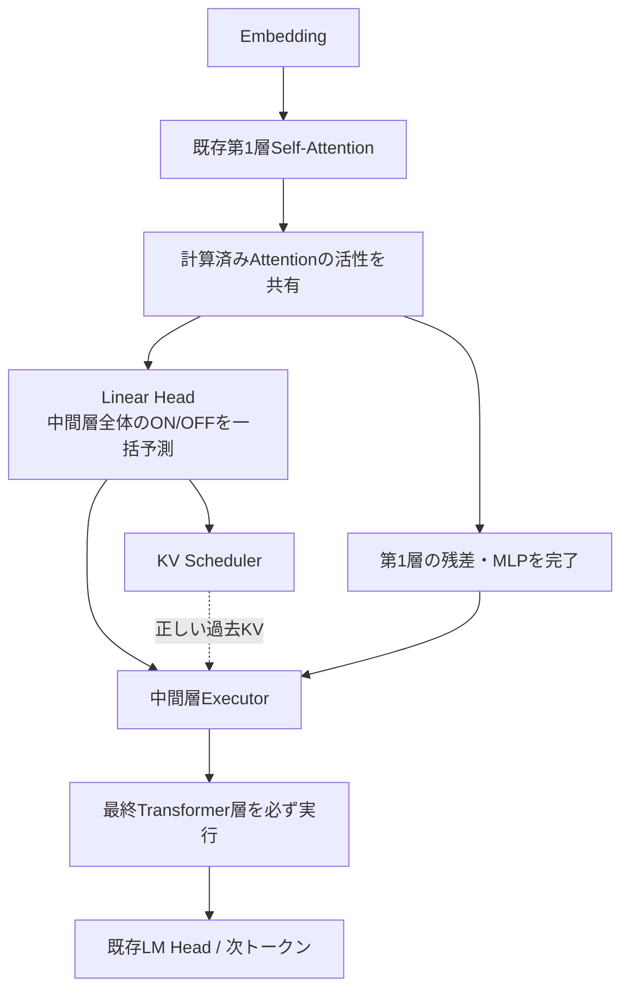

# 11｜第1層Attentionの活性再利用とLinear実行領域Head（正本）

> **研究の中心的な構成。** これは最初から指定されていた計算共有の前提を正確に説明する文書である。**性能改善を確認した結果ではなく、設計仕様**。活性の厳密なTap位置は未決であり、勝手に確定しない。

## 1. 最初から変えない構造

**既存LLMの第1Transformer層Self-Attentionを通常どおり一度だけ実行する。その計算で得た活性を、LLM本体の残りの処理と、実行領域を学習する単一のLinear Headの双方が参照する。**

- Router専用の第2のAttentionモデルや別のLLMを立てない。
- **第1層のSelf-AttentionだけでなくMLPまで必ず実行する**。Headの判定によって第1層を途中で終了しない。
- **Linear Headが生成するのは中間Transformer層すべての実行マスク**であり、Hidden Stateの変換結果ではない。
- **最終層も常時実行**する。その他の中間層はDecodeの各トークンについてON/OFFを一括選択する。
- **重みは全凍結、学習対象はLinear HeadのW,bのみ**。
- 活性共有は**同じ現在トークンのAttention出力を2つの経路で使用すること**。過去トークンのAttention活性を直接コピーすることとは区別する。過去の状態の再利用は通常のKVキャッシュが担う。
- **Linear Headに活性を渡すだけでGPUが速くなったと主張しない**。標準の元モデルは元から第1Attentionを1回実行している。Headの追加行列積・Tensor分岐・同期はコストになる。

## 2. 依存関係（GPU上の並列性までは意味しない）



**Executorのデータ入力**は第1Blockが**完全に終わったHidden State**。**Executorの制御入力**はLinear Headの中間層マスク。この区別を失うと意図しない計算経路になる。

## 3. Attention活性のどこを読むか（まだ未決）

第1層のAttention演算の周辺には、異なるTensorがある。いずれも専用の2回目のAttentionを必要としないが、**数値値・Headの表現力・同期条件は同一ではない**。

| 候補 | Headの入力 | 第1層のMLPを実行するか | 設計上の扱い |
|---|---|---|---|
| **A** | Attention出力射影後、**残差加算の前**の活性ベクトル | **必ず実行** | 未決 |
| **B** | Attention出力の**残差加算後**の活性ベクトル | **必ず実行** | 未決 |
| **C** | 第1Transformer BlockをMLPまで完了したHidden State | **必ず実行** | 以前の文書で使われた入力点。Attentionを再計算しないが、「Attention直後」とは異なる |

**いま確定しているのは「第1Attentionで計算済みの活性を再利用する」という点まで**。A/Bをどちらか選定済みとは扱わない。Cは実装の比較対象・従来表記の対応として残すが、ユーザーの意図を置き換える主方式とはしない。

**注意：** `output_attentions`などで見られる**Attention重み行列**は、ここでいう**活性ベクトル**ではない。Attentionの結果として得られるHidden State側のTensorを参照する。

## 4. 候補A/Bの数理整理

**変数表**

| 記号 | 日本語の意味・定義 | 単位（SI） | 定義域・前提 | 型 |
|---|---|---|---|---|
| \(t\) | Decode位置 | 1 | 1以上 | 整数 |
| \(L\) | Transformer層数 | 1 | Qwen3=28、Nanbeige=52 | 正整数 |
| \(d\) | 隠れ幅 | 1 | Qwen3=1024、Nanbeige=7168 | 正整数 |
| \(x_t\) | 第1層へ入力される隠れ状態 | 1 | \(\mathbb R^d\) | ベクトル |
| \(\mathcal N_A\) | 第1層Attention前の正規化 | 1 | \(\mathbb R^d\to\mathbb R^d\)、LLM重み凍結 | 写像 |
| \(\mathcal A_1\) | 第1層Self-Attention（出力射影を含む） | 1 | \(x_t\)・位置・過去KVを入力とする既存演算 | 写像 |
| \(a_t\) | 第1Attentionの出力射影後、残差加算前の活性 | 1 | \(\mathbb R^d\) | ベクトル |
| \(u_t\) | Attention残差加算後の活性 | 1 | \(\mathbb R^d\) | ベクトル |
| \(\mathcal N_M\) | MLP前の正規化 | 1 | \(\mathbb R^d\to\mathbb R^d\)、凍結 | 写像 |
| \(\mathcal M_1\) | 第1層のMLP | 1 | \(\mathbb R^d\to\mathbb R^d\)、凍結 | 写像 |
| \(h_t^{(1)}\) | 第1Transformer Block完了後の隠れ状態 | 1 | \(\mathbb R^d\) | ベクトル |
| \(f_t\) | Linear Headの選択済み入力（候補A/B） | 1 | \(a_t\)または\(u_t\) | ベクトル |
| \(W\) | 学習可能なLinear Headの重み | 1 | \(\mathbb R^{(L-2)\times d}\) | 行列 |
| \(b\) | 学習可能なLinear Headのbias | 1 | \(\mathbb R^{L-2}\) | ベクトル |
| \(\sigma\) | 要素ごとのSigmoid | 1 | \(\mathbb R\to(0,1)\) | 関数 |
| \(p_t\) | 全中間層のON確率 | 1 | \((0,1)^{L-2}\) | 確率ベクトル |
| \(m_t\) | 全中間層の実行マスク | 1 | \(\{0,1\}^{L-2}\) | 二値ベクトル |

Qwen3/Llama系の**概念上の**第1Blockは：

```math
a_t=\mathcal A_1\!\left(\mathcal N_A(x_t);\ {\rm position,KV}\right),\qquad
u_t=x_t+a_t
```

```math
h_t^{(1)}=u_t+\mathcal M_1\!\left(\mathcal N_M(u_t)\right)
```

Linear Headは**第1層で既に生成した**いずれかの活性を読むだけ：

```math
f_t\in\{a_t,u_t\},\qquad p_t=\sigma(Wf_t+b)
```

**この式はどちらのTapを採用するかを決めていない**。Tapは**モデル・実装の設計として一つを選び、トークンごとにTapを切り替える別の学習対象は作らない**。実際のマスクをサンプリングする確率分布・探索ノイズ・生成報酬の学習条件は[02](02_ROUTER_TRAINING.md)を参照。

**正確性の不変条件：** Headによる判定とは独立に、Executorへ入るLLMのHidden Stateは\(h_t^{(1)}\)。Head出力をLLMのHidden Stateに足したり、MLPを省いたりしてはいけない。

**次元チェック：** 正規化・Attention・MLPと残差の各項はd次元の無次元の内部活性。\(Wf_t+b\)はL−2次元の無次元スコアで、\(\sigma\)により確率になる。

**ERROR CHECK：** モデルのBackend、Fused Kernel、LayerNorm/RMSNorm、RoPE、GQA、Attention Cacheの更新順序が変わればTap取得方法も変わり得る。本節は**設計上の依存関係**を示すだけで、Kernelが並列に実行できること、追加オーバーヘッドゼロであること、精度・高速化を示すものではない。

## 5. KV補完との関係

第1層は常時実行するため、そのAttentionは通常のLLMと同じKVキャッシュを利用する。**中間層をSkipした後、同じ層を再びONにした際に不足する過去KV**は、[03 KV補完](03_KV_CACHE.md)が扱う。

すべての層を同じ経路に固定することではなく、**活性からトークンに適応した複数層の実行領域を学習すること**が主目的。KV補完はその動的経路に従って必要なときだけ正しい値を準備する。

## 6. 参照資料と管理

- [Qwen3DecoderLayer（Transformersの実装）](https://github.com/huggingface/transformers/blob/main/src/transformers/models/qwen3/modeling_qwen3.py)：Self-Attentionの残差加算とMLPの順序の一次コード参照。
- [Nanbeige4.3-33BのモデルConfig](https://huggingface.co/Nanbeige/Nanbeige4.3-33B/blob/main/config.json)：LlamaForCausalLM、52層・隠れ幅7168の構造。

研究方法に関する決定は[DECISIONS](DECISIONS.md)へ追記し、A/BのTapを選ぶまでは**未決**と明示する。

[01 研究の骨格](01_FOUNDATIONS.md)｜[02 Linear Head学習](02_ROUTER_TRAINING.md)｜[03 KV補完](03_KV_CACHE.md)｜[文書ガイド](README.md)
