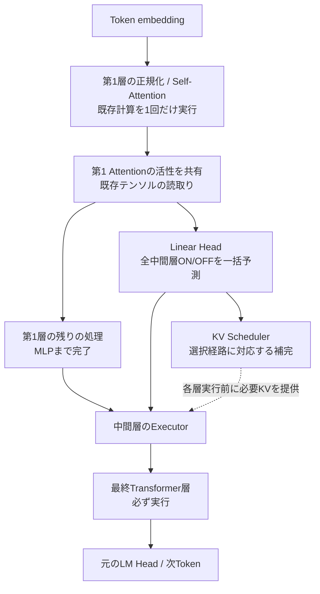

# 11｜第1層Attention活性の共有とLinear実行領域Head（設計整理）

> **区分：** ユーザー意図を反映したアーキテクチャ整理。**コード・学習・性能測定は未実施**。LLM重み凍結・第1/最終層の必須実行・中間全層のトークン別ON/OFFは不変。

## 1. 何を「再利用」するのか

**第1Transformer層のSelf-AttentionをLLM本体とLinear Headのために二重実行しない**。第1層の通常のAttention計算から得られた活性テンソルを、**通常のLLM計算経路**と**実行領域を選ぶLinear Head**の2つの消費者が共有する。

- Linear Headは**LLMの隠れ状態を変換して次層へ挿入するAdapter**ではない。
- Linear Headは、**残りの中間Transformer層をどこまで実行・どこをSkipするか**の全層二値マスクを**1トークンにつき一括**出力する実行領域制御器。
- 「Decision Model」は説明上の機能名であり、**別のLLM・別のAttentionモデル・追加の学習可能な深いネットワークは作らない**。
- **活性の共有**は「同じDecodeステップ内で2経路が同じ値を読む」という意味。**Attention活性を未来トークンへそのまま流用する**という意味ではない。過去トークンに対するAttentionは通常の**K/V Cache**で再利用する。
- 第1層そのものは**必ず最後まで実行**する。最終Transformer層も必ず実行。第1層のMLPをSkip対象に変更するわけではない。

## 2. 処理の正確な依存関係



図は**データ依存・制御依存**であり、CUDA Streamの並列実行が成立するという実測結果ではない。

特に、**Routerが初回Attentionからマスクを決めても、中間層Executorへ渡す隠れ状態は、必ず第1Transformer層のMLPまで完了した出力**である。ここを混同して、第1層MLPを飛ばして中間層へ進めてはいけない。

## 3. 厳密な活性の位置（重要な未決事項）

Qwen3の一般的なDecoder Blockは**第1正規化 → Attention → 残差加算 → 第2正規化 → MLP → 残差加算**の順。Nanbeige4.3-33BはLlama系Decoder構造。参照先：

- [Hugging Face Transformers: Qwen3DecoderLayer](https://github.com/huggingface/transformers/blob/main/src/transformers/models/qwen3/modeling_qwen3.py)
- [NVIDIA NeMo: Nanbeige4.3-33B model architecture](https://docs.nvidia.com/nemo/automodel/model-coverage/large-language-models/nanbeige/Nanbeige4.3-33B)

**第1層のAttentionまで計算した結果を共有する**ことを採用方針とする。ただし、**Linear Headが参照するテンソルの厳密な境界**は以下の2候補を分ける。

| 候補 | Headに与える活性 | 第1Attentionを共有するか | 第1層MLPは必ず動くか | 状態 |
|---|---|---|---|---|
| **A：Attention残差加算後（設計上の第一候補）** | Attentionの出力射影と**残差加算まで完了した活性** | **はい** | **はい** | **暫定案・厳密タップ位置は未確定** |
| **B：第1Block完了後（従来の資料表現）** | Attentionに続くMLPと残差加算まで完了した活性 | はい（Attentionを再実行しない） | はい | 比較する構造候補 |

**採用したい内容に最も近いのはA**。ただし「Attention出力の残差加算前」と「加算後」も異なる値であり、外部仕様・実装で混同してはいけない。残差加算前の生Attention出力を使う案は**第3の未決候補**とし、現段階では選んだと断言しない。

なお、Hugging Faceの`output_attentions`で得られる**Attention重み**と、ここでの**Attention活性ベクトル**は同一ではない。活性共有に必要なのは計算後のHidden State側の値である。

## 4. 数理的な表現（候補Aの場合）

**変数表**

| 記号 | 意味（日本語・定義） | SI単位 | 定義域・前提 | 型 |
|---|---|---|---|---|
| \(t\) | Decodeトークン位置 | 1 | 正整数 | 整数 |
| \(L\) | 全Transformer層数 | 1 | 28/52 | 整数 |
| \(d\) | 隠れ幅 | 1 | Qwen3=1024, Nanbeige=7168 | 整数 |
| \(x_t\) | Embeddingから第1層へ渡すHidden State | 1 | \(\mathbb R^d\) | ベクトル |
| \(\mathcal N_A\) | 第1層Attention前の正規化（固定重み） | 1 | \(\mathbb R^d\to\mathbb R^d\) | 写像 |
| \(\mathcal A_1\) | 第1層Attention演算（出力射影・RoPE・既存KVを含む） | 1 | 入力と既存Cacheから\(\mathbb R^d\) | 写像 |
| \(u_t\) | **第1層Attention後の残差加算済み活性** | 1 | \(\mathbb R^d\) | ベクトル |
| \(\mathcal N_F\) | 第1層MLP前の正規化（固定重み） | 1 | \(\mathbb R^d\to\mathbb R^d\) | 写像 |
| \(\mathcal M_1\) | 第1層MLP（固定重み） | 1 | \(\mathbb R^d\to\mathbb R^d\) | 写像 |
| \(h_t^{(1)}\) | 第1Transformer Blockの完全な出力 | 1 | \(\mathbb R^d\) | ベクトル |
| \(\theta\) | Linear Headの唯一の学習可能なパラメータ組 | 1 | \((W,b)\) | パラメータ組 |
| \(\pi_\theta\) | Headが選ぶ全中間層のマスク確率分布 | 1 | \(\{0,1\}^{L-2}\)上の分布、学習時の探索方式に依存 | 確率分布 |
| \(W\) | Linear Headの重み | 1 | \(\mathbb R^{(L-2)\times d}\) | 行列 |
| \(b\) | Linear Headのバイアス | 1 | \(\mathbb R^{L-2}\) | ベクトル |
| \(p_t\) | 中間全層のON確率 | 1 | \((0,1)^{L-2}\) | 確率ベクトル |
| \(m_t\) | 中間全層の実行マスク（1=ON） | 1 | \(\{0,1\}^{L-2}\) | 二値ベクトル |
| \(\sigma\) | 要素ごとのSigmoid | 1 | \(\mathbb R\to(0,1)\) | 関数 |

第1層のSelf-Attention計算は既存LLMが**一度だけ**行う。

```math
u_t=x_t+\mathcal A_1(\mathcal N_A(x_t)).
```

その活性をLinear Headが**読み取って**中間層全体を決める。

```math
p_t=\sigma(Wu_t+b),\qquad m_t\sim \pi_\theta(\cdot\mid u_t).
```

同じ`u_t`をLLMの第1層MLP側でも使い、第1Blockを完了する。

```math
h_t^{(1)}=u_t+\mathcal M_1(\mathcal N_F(u_t)).
```

**Executorは \(h_t^{(1)}\) から中間層のON/OFFを適用**する。Linear Headの数値出力を直接LLMの隠れ状態へ加えるものではない。

ここで\(\pi_\theta\)の正確な探索分布・学習法は[02 Router学習](02_ROUTER_TRAINING.md)を正本とし、ランダムノイズ・報酬比較・REINFORCE等の候補を維持する。

**次元チェック：** \(\mathcal A_1,\mathcal M_1\)の入出力は\(\mathbb R^d\)。\(Wu_t+b\)は\(L-2\)次元で無次元、確率マスクも無次元で整合。

**ERROR CHECK：** 本式はQwen3/Llama系の**概念上の演算順序**であり、各BackendのFused Kernel・TP Sharding・Attention規約は別。数値的に別の正規化境界やAttention出力を`u_t`とみなすと式が変わる。**候補Aと従来の候補Bを同一モデルとして扱わない**。

## 5. 活性共有が省くもの／省かないもの

| 対象 | 活性共有でどうなるか |
|---|---|
| 第1層AttentionのQKV計算・Attention演算 | **同じDecodeステップでRouter用に再計算しない** |
| 第1層のKV Cache | 既存LLM経路が通常生成し、Routerはこれを重複生成しない |
| 第1層MLP | 必ず実行。Linear Headの入力と並行関係にできても、計算を省略するわけではない |
| 中間層の計算 | Headが選択するマスクに基づいて実行/Skipされる |
| 中間層の欠損KV | Schedulerが正しい層入力・位置から補完する |
| Linear Headの行列積 | **追加のGPU処理**として発生する。共有によってこの費用がゼロにはならない |
| 活性の分岐・Tensor Buffer・同期 | **追加費用があり得る**。Fused KernelやStreamに依存するので高速化は未確認 |

**学習時の勾配条件：** LLM全重みを凍結し、Linear Headだけ勾配を保持する。既存活性は読み取り専用（必要に応じてdetach）で利用し、LLMの本体経路へ勾配・in-place変更を伝播させない。

## 6. 今回の更新による責任分界

- **共通Attention Prefix**：LLM本体に存在する第1Attentionの演算と、その活性を一回だけ計算。
- **Linear Decision Head**：共有活性から**トークンに適応した全中間層ON/OFF**を一括予測。
- **LLM Layer Executor**：元の第1層を完成してからマスクに従う。第1・最終層は常時ON。
- **KV Scheduler**：中間層で発生するKV欠損の保存・補完を管理。**Headのマスクを勝手に上書きしない**。
- **学習目的**：生成品質（維持・改善）と実GPU時間。**固定マスク維持を目的にしない**。

この構造は、**二重計算の除去（活性共有）**と**動的な経路学習**を明確に分ける。両者は補完関係だが、活性共有だけを新規性と主張しない。

## 7. 残すべき未決事項

1. **タップ位置**：候補A（Attentionの残差加算後）を第一候補にするか、残差加算前や候補B（第1Block完了後）を主方式にするか。
2. **Tensor値の定義**：モデルごとの正規化・残差・Attention出力射影・GPU Backendとの対応。
3. **速度費用**：活性分岐・Head実行・同期が、二重Attention不要という設計上の利益を損なわないか。

上記は確認・理論整理すべき事項であって、**実装・実験を開始したという意味ではない**。

[01 研究の骨格](01_FOUNDATIONS.md)｜[02 Router学習](02_ROUTER_TRAINING.md)｜[07 学習方策](07_POLICY_LEARNING_PIPELINE.md)｜[文書ガイド](README.md)
